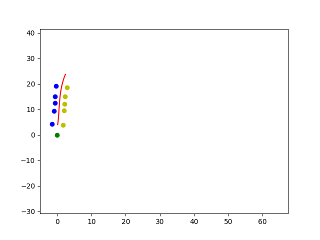

# ft-fsd-path-planning

FaSTTUBe Formula Student Driverless Path Planning Algorithm

<!--  -->

| With color information | Without color information |
| ---------------------- | ------------------------- |
| Autocross FSG 2019
|      |                     |
| Skidpad |
|   |   |

> [!NOTE]
> You can find an interactive demo of the algorithm <a href="https://ft-fsd-path-planning.streamlit.app//" target="_blank">here.</a>

## Updates 

### v0.6.0 (unreleased)

A restructuring release: every stage now follows the same pattern, the
package has one layout, and the planner reports how it is doing. The output
is unchanged: byte-identical to 0.5.0 on every frame of the bundled datasets.

#### Structure

- The stages live under `fsd_path_planning.stages`: `sorting`, `matching`, `path` and `relocalization`, and the planner in `fsd_path_planning.pipeline`. Generic maths lives in `fsd_path_planning.geometry`, with no planner imports. The old module paths still work, with a warning, until 0.7.0; see the migration guide below.
- Each mission's setup (path calculation, relocalizer, default settings) is in one registry, `fsd_path_planning.missions`.
- Path calculation is built from strategy objects (`stages.path.strategies`): which points the path goes through, and how it is fitted. Skidpad's figure-of-eight following is one of them. The sorting cost is a list of terms, `COST_TERMS`, one per weight. Relocalization transforms are `SE2Transform` objects instead of pairs of closures.

#### Stage contracts

- Every stage — `ConeSorting`, `ConeMatching`, `CalculatePath` and the relocalizers — has a `run(stage_input)` method that takes an input dataclass and returns a frozen result dataclass (the `Stage` protocol in `fsd_path_planning.stages`). The named methods (`run_cone_sorting()` and so on) still work.
- Expected outcomes are part of the result, not exceptions. `SortingResult.left_outcome` and `right_outcome` say whether each side's trace was found, and if not, why (`TraceOutcome`). `RelocalizationResult.outcome` says whether the car is relocalized yet (`RelocalizationOutcome`).
- Mission-specific setup lives in one registry, `fsd_path_planning.missions`. `MissionToRelocalizer` still works and has the same contents.

- `PathPlanner.plan()` returns everything the planner produced for a frame as a `PlannerResult`: the path, the health, and each stage's result. `calculate_path_in_global_frame()` is unchanged; `last_result` keeps the latest `PlannerResult`.

#### Error handling and health

- An error policy: `PipelineConfig.on_error` is `"recover"` by default (as before: the fallback runs, and now the error is logged with its stack trace) or `"raise"` (the error propagates). `FSD_PATH_PLANNING_STRICT=1` selects `"raise"` from the environment. See [Error handling and health](#error-handling-and-health).
- `PathPlanner.health` counts recoveries and frames since the last good path, for publishing as diagnostics.
- Optional bounds on recovery: past them the planner returns an empty path instead of a stale one.

#### Faster

- The matching candidate search is compiled with Numba. On the trackdrive datasets a frame is about 10% faster at the median than with 0.5.0, and 6–28% faster at the 95th percentile, depending on the run; skidpad is unchanged.

#### Fixes

- An exactly straight path made the path extension repeat its last point, so the refit failed and the previous path was used instead. Found by the new strict mode.
- `MatchingConfig.virtual_cone_angle_threshold`, `SkidpadConfig` and three distances in the known-map path code were settings that did nothing; they now take effect. With default values nothing changes.
- The Streamlit demo's sorting page crashed on a settings check; both demos now run in CI.
- Dependencies have minimum versions and no maximum: numba 0.58, NumPy 1.25, SciPy 1.10, typing_extensions 4.0. CI tests the minimums.

#### Migration guide

The patterns below from earlier releases still work but emit a warning.
Update them at your convenience — they will be removed in a future release.

**1. Keyword-argument constructors**

Old (deprecated):

```python
sorter = ConeSorting(max_n_neighbors=5, max_dist=6.5)
matcher = ConeMatching(min_track_width=3.0)
pather = CalculatePath(smoothing=0.2, mpc_path_length=20.0)
```

New (use a config dataclass):

```python
from fsd_path_planning.config_dataclasses import (
    SortingConfig,
    MatchingConfig,
    PathConfig,
)

sorter = ConeSorting(config=SortingConfig(max_n_neighbors=5, max_dist=6.5))
matcher = ConeMatching(config=MatchingConfig(min_track_width=3.0))
pather = CalculatePath(config=PathConfig(smoothing=0.2, path_length=20.0))
```

**2. `set_new_input()` + `calculate()` pattern**

Old (deprecated):

```python
sorter.set_new_input(sorting_input)
result = sorter.run_cone_sorting()
```

New (pass input directly):

```python
result = sorter.run_cone_sorting(sorting_input)
```

**3. Moved modules**

These modules moved. The old paths forward to the new ones and emit an
`FsdPathPlanningDeprecationWarning` (a `UserWarning`, so it is shown wherever
your code runs) until 0.7.0.

| Old path | New path |
| --- | --- |
| `fsd_path_planning.types` | `fsd_path_planning.common_types` |
| `fsd_path_planning.utils.math_utils` | `fsd_path_planning.geometry` (split by topic: `vectors`, `angles`, `transforms`, `distances`, `traces`, `shapes`) |
| `fsd_path_planning.utils.spline_fit` | `fsd_path_planning.geometry.splines` |
| `fsd_path_planning.sorting_cones.trace_sorter.line_segment_intersection` | `fsd_path_planning.geometry.segments` |
| `fsd_path_planning.full_pipeline.full_pipeline` | `fsd_path_planning.pipeline` |
| `fsd_path_planning.sorting_cones.core_cone_sorting` | `fsd_path_planning.stages.sorting.stage` |
| `fsd_path_planning.sorting_cones.trace_sorter.core_trace_sorter` | `fsd_path_planning.stages.sorting.trace_sorter` |
| `fsd_path_planning.sorting_cones.trace_sorter.end_configurations` | `fsd_path_planning.stages.sorting.search` |
| `fsd_path_planning.sorting_cones.trace_sorter.find_configs_and_scores` | `fsd_path_planning.stages.sorting.scoring` |
| `fsd_path_planning.sorting_cones.trace_sorter.cost_function` | `fsd_path_planning.stages.sorting.costs` |
| `fsd_path_planning.sorting_cones.trace_sorter.cone_distance_cost` | `fsd_path_planning.stages.sorting.distance_cost` |
| `fsd_path_planning.sorting_cones.trace_sorter.nearby_cone_search` | `fsd_path_planning.stages.sorting.nearby_cones` |
| `fsd_path_planning.sorting_cones.trace_sorter.adjacency_matrix` | `fsd_path_planning.stages.sorting.adjacency` |
| `fsd_path_planning.sorting_cones.trace_sorter.combine_traces` | `fsd_path_planning.stages.sorting.combine` |
| `fsd_path_planning.sorting_cones.trace_sorter.common` | `fsd_path_planning.stages.sorting.common` |
| `fsd_path_planning.cone_matching.core_cone_matching` | `fsd_path_planning.stages.matching.stage` |
| `fsd_path_planning.cone_matching.functional_cone_matching` | `fsd_path_planning.stages.matching.virtual_cones` |
| `fsd_path_planning.cone_matching.match_directions` | `fsd_path_planning.stages.matching.search_directions` |
| `fsd_path_planning.calculate_path.core_calculate_path` | `fsd_path_planning.stages.path.stage` |
| `fsd_path_planning.calculate_path.skidpad_calculate_path` | `fsd_path_planning.stages.path.skidpad` |
| `fsd_path_planning.calculate_path.strategies` | `fsd_path_planning.stages.path.strategies` |
| `fsd_path_planning.calculate_path.path_basis_selector` | `fsd_path_planning.stages.path.centerline` |
| `fsd_path_planning.calculate_path.path_extender` | `fsd_path_planning.stages.path.extension` |
| `fsd_path_planning.calculate_path.path_parameterization` | `fsd_path_planning.stages.path.parameterization` |
| `fsd_path_planning.calculate_path.path_calculator_helpers` | `fsd_path_planning.stages.path.helpers` |
| `fsd_path_planning.relocalization.relocalization_base_class` | `fsd_path_planning.stages.relocalization.base` |
| `fsd_path_planning.relocalization.relocalization_information` | `fsd_path_planning.stages.relocalization.information` |
| `fsd_path_planning.relocalization.acceleration.acceleration_relocalization` | `fsd_path_planning.stages.relocalization.acceleration` |
| `fsd_path_planning.relocalization.skidpad.skidpad_relocalizer` | `fsd_path_planning.stages.relocalization.skidpad` |
| `fsd_path_planning.relocalization.skidpad.skidpad_path_data` | `fsd_path_planning.stages.relocalization.skidpad_path_data` |

Code that only imports from `fsd_path_planning` itself (`PathPlanner`,
`MissionTypes`, `ConeTypes`, ...) needs no change.

Every geometry function can also be imported from `fsd_path_planning.geometry`
directly. Some names changed on the way: `my_cdist_sq_euclidean` is now
`cdist_sq_euclidean`, `my_in1d` is `fsd_path_planning.utils.arrays.in1d`, and
`SplineFitterFactory` is `SplineFitter` (and `CalculatePath.spline_fitter_factory`
is `spline_fitter`). The old names still work, with the same warning. `lerp`, `linearly_combine_values_over_time`, `odd_square` and the
quaternion conversions in `math_utils` are no longer used by the planner and
have no new home; they are removed in 0.7.0. `CalculatePath.path_updates`,
`mpc_paths` and `path_is_trivial_list`, which nothing reads, warn on access and
are removed in 0.7.0 too.

### v0.5.0 (unreleased) :star: 100 stars!

This release focuses on code quality, modularity, and developer experience, with the goal of making the codebase easier to understand, maintain, and extend. The algorithm is unchanged, but a handful of fixes change its output slightly: on the bundled datasets the planned line moves sideways by at most 0.8 mm, apart from a single frame at 11.7 mm (see below).

#### Fixes and output changes

- **The output is now reproducible.** Path sampling sat exactly on a floating-point edge: whether the planner resampled the path with *n* or *n+1* points was decided by the last bits of a float, so a sub-nanometre change in the input, or a different NumPy, SciPy or BLAS build, could change the returned path array by up to 0.17 m. The sample count is now fixed. The planned line itself moves by at most 0.8 mm on the bundled datasets, apart from one frame at 11.7 mm where only one side of the track is visible.
- **`PathPlanner(config=...)` is now used.** The config used to be stored and then ignored in favour of the defaults. The cost weights, the car size and several distance thresholds now come from `SortingConfig` instead of literals in the code.
- **Cones as one `(N, 3)` array of `[x, y, cone_type]` rows are officially supported**, through the new `normalize_cones()`. This format used to crash the acceleration mission.
- **Acceleration relocalization is reproducible.** It draws from its own seeded random generator instead of NumPy's global one.
- **No state is shared between planners.** The remaining process-wide caches are gone, so two planners in one process, or in two threads, cannot hand results to each other.
- **The skidpad reference path is stored as a 6 kB spline** instead of a 234 kB Python literal. The path moves by at most 0.45 mm.
- **scikit-learn is no longer a dependency.** It was used for one DBSCAN call in the skidpad relocalization, which is now the equivalent single-linkage clustering in SciPy, with identical results.
- **`warmup()` compiles everything before the car moves.** See [Warm-up](#warm-up).
- Smaller fixes: `Timer.get_std_time()` returned the mean; `Timer.report_mean_time()` raised; a fallback in the path calculation passed the wrong columns; the nearby-cone cache ignored the search geometry.

Removed from internal modules: `adjacency_matrix.calculate_distance_matrix`, `adjacency_matrix.find_k_closest_in_point_cloud`, `nearby_cone_search.NEARBY_CONE_SEARCH_CACHE` and `nearby_cone_search.clear_nearby_cone_search_cache`. `MatchingConfig` now defaults to non-monotonic matching, which is what `PathPlanner` has always used; code that builds a `ConeMatching` directly from a default `MatchingConfig` gets non-monotonic matches unless it sets `matches_should_be_monotonic=True`.

Python 3.10 is the minimum supported version. It stays the minimum until ROS 2 Humble, whose Ubuntu 22.04 ships Python 3.10, reaches its end of life in May 2027.

#### API improvements

- Pipeline modules (`ConeSorting`, `ConeMatching`, `CalculatePath`) now accept input via `run_*()` methods with dedicated input dataclasses, replacing the old `set_new_input()` + `calculate()` pattern. The old pattern still works but emits a `DeprecationWarning`.
- Pipeline modules return typed result dataclasses (`SortingResult`, `MatchingResult`, `PathResult`) that also support tuple unpacking for backward compatibility.
- Consistent field naming across all modules: `vehicle_position`, `vehicle_direction`, `cones_by_type`.
- `PathPlanner` now supports dependency injection — pass custom `cone_sorting`, `cone_matching`, or `pathing` instances to the constructor.

#### Modularity

- `CalculatePath` internals extracted into `path_basis_selector` (side selection, centerline) and `path_extender` (path connection, extension, trimming).
- Long function `neighbor_bool_mask_can_be_added_to_attempt()` broken into focused helpers: `_check_angle_continuity()`, `_check_forward_direction()`, `_check_no_car_collision()`.
- Module-level global caches replaced with instance-scoped `AdjacencyMatrixCache` and `NearbyConeSearcher`, owned by `TraceSorter`.
- Relocalization and standard sorting+matching flows extracted into separate methods in `PathPlanner`.

#### Configuration

- All magic numbers extracted into dataclass-based configs: `SortingConfig`, `MatchingConfig`, `PathConfig`.
- Configs are optional constructor parameters with sensible defaults.
- Configs are frozen: a stage reads its config once, when it is built, so a later change would silently not apply. Make a changed copy with `dataclasses.replace(PathConfig(), smoothing=0.5)`.
- `PipelineConfig` includes the skidpad relocalization settings (`SkidpadConfig`), which the skidpad relocalizer now actually uses.
- `PathConfig` uses the clearer names `path_length` and `number_of_samples`; the old `mpc_path_length` and `mpc_prediction_horizon` names still work as compatibility aliases.

#### Tooling

- Migrated to [uv](https://docs.astral.sh/uv/) for dependency management and builds (hatchling backend).
- Replaced black + pylint + mypy with [ruff](https://docs.astral.sh/ruff/) (linting & formatting) and [pyright](https://github.com/microsoft/pyright) (type checking).
- Added [nox](https://nox.thea.codes/) for automated multi-version testing (Python 3.10–3.13).
- Added GitHub Actions CI running lint, type check, and tests on every push/PR.
- Added `py.typed` marker (PEP 561) for downstream type checking.
- Added explicit `__all__` to the public API.

### December 2023, July 2024 (v0.4)

#### (v0.4.3)

- Added `Acceleration` relocalization and stable acceleration path calculation.
- Added caching mechanism for the sorting step (about 20% performance improvement). 

> [!IMPORTANT]
> The caching step slightly changes the logic of the algorithm and has not been thoroughly tested. By default, the caching is disabled. To enable it, set the `experimental_performance_improvements` parameter of the `PathPlanner` class to `True`.

#### (v0.4.1)

Added a property to the PathPlanner class that gives information about the relocalization process. The property is called `relocalization_info` and is a dataclass called `RelocalizationInformation`. It contains the following fields:

- `translation` - A 2d array with the translation of the relocalization
- `rotation` - A float with the rotation of the relocalization

If the relocalization process has not been run, or is not relevant (currently only Skidpad has relocalization), the property will return `None`.

The internal Skidpad frame has its origin at the center of the Skidpad, with the x-axis pointing towards the exit of the Skidpad and the y-axis pointing to the left-hand loop.

#### (v0.4.0)

Further improvements were added in December 2023. The main focus was to make the Skidpad mission more robust. The algorithm now uses a different approach for the Skidpad mission, which is much simpler and does not rely on the color of the cones at all.

The logic that runs during the Skidpad mission is stateful, so if you want to use it, you will have to review the usage of the relevant classes including `PathPlanner`. More specifically, while in the past one could create a new instance of the `PathPlanner` class, for each computation, with minimal performance penalties, now this will cause the Skidpad path calculation to fail. It is recommended to create a new instance of the `PathPlanner` class when the vehicle enters `AS-READY` state and the SLAM pose has stabilized.

This version also adds `scikit-learn` as a dependency, which is used for the Skidpad mission. You may use the `summer-23` tag if you want to use the version of the algorithm that does not require `scikit-learn` and does not have the Skidpad improvements.

### March 2023 (v0.3)

 In March 2023, a further development of this algorithm was published. The new version has two main improvements:

- The algorithm can now work without color. It can use cones for which the color is known and cones for which the color is unknown at the same time.
- Performance improvements. The algorithm is faster, with the main focus of improvement being the cone sorting step.

## Introduction

This repository contains the path planning algorithm developed by FaSTTUBe for the 2021/22 and 2022/23 Formula Student seasons.

The intention of this repository is to provide teams entering the driverless category with a path planning algorithm, so that they can get up and running as fast as possible. Teams are encouraged to use this repository as a basis and adapt it to their own pipeline, as well as make changes that will improve the algorithm's performance. If your team decides to use this repository, feel free to inform us. We would be happy to hear about your experience.

The algorithm differs from other common path planning approaches in that it can very robustly handle one side of the track not being visible, for example the inside of a corner. This is a common problem in the driverless category, especially for teams with less sophisticated detection pipelines.

Parts that are specific to the FaSTTUBe pipeline have been removed. The algorithm is now a standalone library that can be used in any pipeline. It is a Python package that can be installed using [uv](https://docs.astral.sh/uv/).

The algorithm requires the following inputs:

- The car's current position and orientation in the slam map
- The position of the (optionally colored) cones in the slam map

The algorithm outputs:

- Samples of a parameterized b-spline with the x,y and curvature of the samples

The algorithm is completely stateless. Every time it is called no previous results are
used. The only aspect that can be used again is the path that was previously generated.
It is only used if the path calculation has failed.

The parts of the pipeline are also available as individual classes, so if you only
want to use parts of it you can do so.

The codebase is written entirely in Python and makes heavy use of NumPy, SciPy, and Numba.

The algorithm has demonstrated its success as part of the FaSTTUBe pipeline, contributing to a 2nd place finish in Trackdrive at FS Czech 2023.

## Installation

The package can be installed using [uv](https://docs.astral.sh/uv/):

```bash
uv add "fsd-path-planning[demo] @ git+https://github.com/papalotis/ft-fsd-path-planning.git"
```

This will also install the dependencies needed to run the demo (cli, matplotlib, streamlit, etc.). If you don't want to install the demo dependencies, you can install the package without the `demo` extra:

```bash
uv add "fsd-path-planning @ git+https://github.com/papalotis/ft-fsd-path-planning.git"
```

You can also clone the repository and install the package locally:

```bash
git clone https://github.com/papalotis/ft-fsd-path-planning.git
cd ft-fsd-path-planning
uv sync --extra demo
```

You can again skip the `--extra demo` if you don't want to install the demo dependencies.

<details>
<summary>Installation with pip</summary>

You can also use pip directly:

```bash
pip install "fsd-path-planning[demo] @ git+https://github.com/papalotis/ft-fsd-path-planning.git"
```

Or for a local install:

```bash
pip install -e .[demo]
```

</details>

## Performance

The algorithm (with default parameters) is fast enough to run in real-time on a Jetson Xavier AGX 16GB on MAXN power mode. On that platform, the algorithm takes on average around 10ms from start to finish. You can run the demo to get an idea of the performance on your hardware.

*Note that the first time that you run the algorithm, it will take around 30-70 seconds to compile all the Numba functions. The compiled code is cached on disk, so later starts take about a second. Run the demo a second time to get a real indicator on performance.*

### Warm-up

Numba compiles a function the first time each branch of the planner reaches it,
so without help the compilation happens in the middle of a run: on a fresh
install, a single frame can take seconds. Call `warmup()` once while the vehicle
is still standing, for example when your node starts or the car enters
AS-READY:

```python
from fsd_path_planning import warmup

warmup()  # about a second with a warm cache, about a minute on a fresh install
```

It drives throwaway planners through synthetic trackdrive, acceleration and
skidpad situations, so that nothing is left to compile once the car moves. On
the bundled datasets no frame after the warm-up needs a compile.

Run the following command to run the demo on your machine:

```bash
uv run python -m fsd_path_planning.demo
```

## Basic usage

```python
from fsd_path_planning import PathPlanner, MissionTypes, ConeTypes

path_planner = PathPlanner(MissionTypes.trackdrive)
# you have to load/get the data, this is just an example
global_cones, car_position, car_direction = load_data()
# global_cones must contain exactly 5 numeric numpy arrays with shape (N, 2),
# where N is the number of cones of that type

# ConeTypes is an enum that contains the following values:
# ConeTypes.UNKNOWN which maps to index 0
# ConeTypes.RIGHT/ConeTypes.YELLOW which maps to index 1
# ConeTypes.LEFT/ConeTypes.BLUE which maps to index 2
# ConeTypes.START_FINISH_AREA/ConeTypes.ORANGE_SMALL which maps to index 3
# ConeTypes.START_FINISH_LINE/ConeTypes.ORANGE_BIG which maps to index 4

# car_position must be a finite 2D numpy array with shape (2,)
# car_direction must be either:
# - a finite 2D numpy array with shape (2,) representing the car's direction vector
# - a finite float representing the car's direction in radians
# A zero direction vector is rejected.

path = path_planner.calculate_path_in_global_frame(
    global_cones, car_position, car_direction
)

# path is a Mx4 numpy array, where M is the number of points in the path
# the columns represent the spline parameter (distance along path), x, y and path curvature
```

`calculate_path_in_global_frame()` validates its public inputs before running the
pipeline. Invalid inputs raise `TypeError` or `ValueError` with a stable error
message instead of failing later in the geometry code.

The most important input rules are:

- `global_cones` must be either of the two accepted formats below.
- `car_position` must be numeric, finite, and shaped `(2,)`.
- `car_direction` must be either a finite scalar angle or a finite non-zero vector
  shaped `(2,)`.

### Cone input formats

Cones can be passed in either of two ways:

1. Exactly 5 arrays ordered by `ConeTypes`, each numeric, finite and shaped
   `(N, 2)`. Use `np.zeros((0, 2))` for a cone type you have none of.
2. A single numeric, finite `(N, 3)` array whose rows are `[x, y, cone_type]`,
   where `cone_type` is a whole number from the `ConeTypes` enum.

The second form is converted to the first on entry. You can call the conversion
yourself:

```python
from fsd_path_planning import normalize_cones

cones_by_type = normalize_cones(cones_as_nx3_array)
```

Within a cone type the input order is kept, but a flat array is regrouped by
type, so the planner sees the cones in a different order than they were given.
That can change which of two equally good sorted traces wins.

Take a look at this notebook for a more detailed example: [simple_application.ipynb](fsd_path_planning/demo/simple_application.ipynb)

> [!TIP]
> There is no resetting functionality in the classes. If you want to reset the path planner, you can simply create a new instance of the class.
It is recommended to create a new instance of the relevant classes when the vehicle enters `AS-READY` state.

## Error handling and health

A few steps of the path calculation have a fallback for when they fail, such
as a spline that will not fit. What happens then is the error policy:

```python
from dataclasses import replace
from fsd_path_planning import MissionTypes, PathPlanner
from fsd_path_planning.config_dataclasses import PipelineConfig

# "recover" (default): run the fallback, log the error with its stack trace
# "raise": let the error propagate, for CI, tests and offline replays
config = replace(PipelineConfig(), on_error="raise")
planner = PathPlanner(MissionTypes.trackdrive, config=config)
```

Setting the environment variable `FSD_PATH_PLANNING_STRICT=1` selects
`"raise"` whatever the config says; CI runs the tests that way.

Too few cones, or a path too far from the car to trust, are not errors: the
planner reuses the previous path and marks the frame as degraded. After each
frame, `planner.health` says how things stand:

```python
# plan() returns everything; calculate_path_in_global_frame() works too
result = planner.plan(cones, car_position, car_direction)
health = planner.health
health.status  # PathStatus.OK, DEGRADED, RECOVERED or NO_VALID_PATH
health.recoveries_by_kind  # e.g. {"spline_fit_failed": 2}
health.frames_since_good_path
health.distance_since_good_path  # meters
health.last_recovery  # what failed, where, and its traceback
```

To stop following a stale path, set `max_consecutive_recoveries` or
`max_distance_without_good_path` on `PipelineConfig`. Past either, the frame's
status is `NO_VALID_PATH` and the planner returns an empty `(0, 4)` path. Both
are off by default.

## Development

### Setup

```bash
git clone https://github.com/papalotis/ft-fsd-path-planning.git
cd ft-fsd-path-planning
uv sync --extra dev --extra test
```

### Running tests

```bash
uv run pytest
```

### Multi-version testing

The project uses [nox](https://nox.thea.codes/) to test against multiple Python versions:

```bash
uv run nox -s tests          # test on Python 3.10, 3.11, 3.12, 3.13
uv run nox -s tests-3.12     # test on a specific version
uv run nox -s tests-lowest   # the oldest allowed dependency versions
uv run nox -s demo           # run both demos headless
uv run nox -s differential -- --with-cache  # every frame against golden-v1
uv run nox -s lint            # run ruff linter and formatter check
uv run nox -s typecheck       # run pyright type checking
```

### Package layout

```
fsd_path_planning/
  pipeline.py        PathPlanner: runs the stages for each frame
  missions.py        what each mission needs: stages and default settings
  config_dataclasses.py  frozen settings for every stage
  health.py          error policy and the health record
  common_types.py    array aliases and the stage results
  stages/            one package per stage, each with a stage.py entry point
    base.py          the Stage protocol: run(stage_input) -> result
    sorting/  matching/  path/  relocalization/
  geometry/          pure 2D maths: vectors, angles, transforms, splines, ...
  warmup.py          compile every Numba function before the car moves
```

### Type checking

The package ships a `py.typed` marker (PEP 561), so type checkers like pyright will pick up the inline type annotations automatically when using the package as a dependency.

## Previous versions

Alternate versions of the algorithm are available as git tags:

- `color-dependent` - The algorithm needs color information to work. This version was used in the 2021/22 season.
- `summer-23` - The algorithm can work without color information. This version was used in the 2022/23 season.
